 

[🇪🇸 Español](README.md) · [🇬🇧 English](README.en.md)

## 💻 About me

> Most of my work lives in private institutional repositories; this profile does not reflect all of my contributions.

## 🚀 Career

## 🛠️ Tech stack

## 📂 Projects

## 🎓 Education & courses

## 🚀 Contribution space battle

