 

[🇪🇸 Español](README.md) · [🇬🇧 English](README.en.md)

## 💻 Sobre mí

> La mayor parte de mi trabajo está en repositorios privados institucionales; este perfil no refleja todas mis contribuciones.

## 🚀 Trayectoria

## 🛠️ Tecnologías

## 📂 Proyectos

## 🎓 Formación y cursos

      

## 🚀 Batalla espacial de contribuciones

